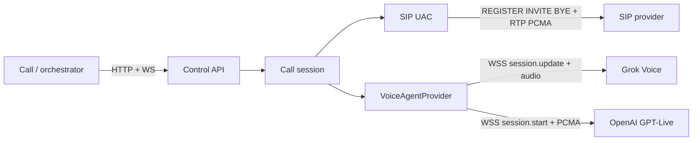

# Bot Call Bridge (`bot-call-bridge`)

Headless phone bridge: **SIP** ↔ **OpenAI GPT-Live-1** or **xAI Grok Voice**. The far-end of the call talks to the voice model. There is no local microphone or speaker.

Switch voice with `VOICE_PROVIDER=openai|grok|mock` — paste only the matching API key; models/voices/URLs ship with working defaults.

An orchestrator (or a Grok Bot **Call** agent) posts a SCRIPT — who to call, language, goals, constraints, fallbacks, AI disclosure. This process registers to **your** SIP provider, dials, and pipes G.711 a-Law RTP to/from the voice WebSocket as a virtual mic/speaker.

SIP is provider-agnostic (`SIP_REGISTRAR` / `SIP_PROXY` / `SIP_DOMAIN`). Voice is provider-agnostic behind `VoiceAgentProvider` (Grok Realtime and OpenAI GPT-Live for PCMA duplex).

**Reference live path** for a cloud / Grok-bot box: **[OVH SIP](docs/providers/ovh.md)** (softphone line, `sip3.ovh.fr`-class registrar). VoipWise is documented but often rejects datacenter IPs — see [providers](docs/providers/README.md).



A warm handoff adds a second outbound dialog on the same registration and relays RTP inside this process. The voice model drops out of the audio path once both people are connected. SIP REFER is not used (the bridge would leave the call). See [Warm handoff](#warm-handoff).

## Repo map

| Path | Role |
|---|---|
| `src/call_bridge/` | Bridge runtime (SIP, RTP, voice, HTTP/WS) |
| `docs/providers/` | How to add / operate a SIP carrier |
| `skills/` | Call-bot skills (setup, troubleshoot, handle-a-call, package) |
| `bot/` | Call persona + memory stubs for a later Grok Bot share |
| `examples/` | Anonymized SCRIPT samples (`script.sample.json`, `demo-fr.json`, `sample-outbound.json`) |
| `scripts/package-call-bot.sh` | Assemble a shareable staging folder |

## Using with a shared Call bot

A shared Grok Bot **Call** template only ships profile, skills, and memories. Clone this repo (`git clone https://github.com/theophanemayaud/bot-call-bridge.git`), install the bridge, and point Call at **your** private control plane. The bot is the orchestrator; this process is the SIP stack. Do not put SIP passwords or API keys in the bot share.

## Quickstart (mock)

No SIP creds or xAI key required.

```bash
python3 -m venv .venv
source .venv/bin/activate
pip install -e ".[dev]"
cp .env.example .env
BRIDGE_MODE=mock python -m call_bridge
```

Open [http://127.0.0.1:43123](http://127.0.0.1:43123). Place `examples/script.sample.json`. The mock voice discloses, asks the orchestrator a question, and waits for a tool result.

```bash
pytest
```

## Live requirements

1. A SIP **softphone** line that accepts REGISTER from **this machine’s egress IP**. Cloud box → start with [OVH](docs/providers/ovh.md).
2. Voice key: `XAI_API_KEY` + `VOICE_PROVIDER=grok`, or `OPENAI_API_KEY` + `VOICE_PROVIDER=openai`.
3. UDP open for `SIP_LOCAL_PORT` (default **5062**, unprivileged) and `SIP_RTP_PORT_START`–`END`.
4. Reachable RTP: `SIP_ADVERTISE_HOST` or STUN (`STUN_SERVER`).

```bash
cp .env.example .env
# fill SIP_* from docs/providers/<your-provider>.md
# fill XAI_API_KEY
set -a && source .env && set +a
BRIDGE_MODE=live VOICE_PROVIDER=grok python -m call_bridge
```

Live boot **fails fast** if registrar/domain/creds or `XAI_API_KEY` are missing, or if REGISTER is rejected. `+33…` is rewritten to `00…` for the SIP URI.

See `skills/setup/SKILL.md` for the operator checklist and `skills/troubleshoot/SKILL.md` when REGISTER/audio fails.

## Control API

| Action | Endpoint |
|---|---|
| Dial | `POST /v1/calls` `{ "script": {…} }` |
| Hang up | `POST /v1/calls/{id}/hangup` |
| Mid-call steer | `POST /v1/calls/{id}/guidelines` `mode=steer\|speak` |
| Answer a tool | `POST /v1/calls/{id}/tool-results` |
| Live events | `WS /v1/calls/{id}/events` |
| Warm handoff | `POST /v1/calls/{id}/handoff` `{ "action": "human_answered" \| "bring_in_owner" }` |
| Health | `GET /health` · `GET /v1/status` |

Agent context (goals, ownership, what not to add) and Call-agent contract: [`AGENTS.md`](AGENTS.md). Sample SCRIPT: `examples/script.sample.json`. Other generic demos: `examples/demo-fr.json`, `examples/sample-outbound.json`.

## Voice providers

- **Grok** — `wss://api.x.ai/v1/realtime`, native `audio/pcma`, `server_vad`, function tools, `force_message`.
- **OpenAI GPT-Live-1** — `wss://api.openai.com/v1/live/sessions`, native `audio/pcma` @ 8 kHz (rate required), client delegation for hangup / ask_orchestrator (goodbye / "I'll hang up" classified as hangup; explicit hangup speech still BYEs if the model never delegates). Set `VOICE_PROVIDER=openai` plus `OPENAI_API_KEY`, optional `OPENAI_LIVE_MODEL` / `OPENAI_VOICE` (e.g. `marin`, `cedar`). `speak_verbatim` uses `session.instructions.append` (no Grok `force_message`).

## Add a VoIP provider

Write `docs/providers/<name>.md` using the [checklist](docs/providers/README.md). Fill `SIP_*`. No code change unless the carrier needs a dial or transport exception.

## Warm handoff

Opt in per SCRIPT when the bot should wait on hold, then bring a person in on a second call. The owner number is `HANDOFF_OWNER_NUMBER` (or `handoff.to` / `handoff_to` on that SCRIPT). Do not commit a real number.

```json
{
  "call": { "to": "+33XXXXXXXXX", "language": "fr" },
  "mission": { "disclosure": "…", "goals": ["Wait for a person, then connect the owner"] },
  "handoff": {
    "owner_name": "the owner",
    "connect_line": "Un instant, je vous mets en relation avec le propriétaire.",
    "context": "L'agent du support est en ligne.",
    "lead_seconds": 0,
    "on_unavailable": "tell"
  }
}
```

`examples/script.handoff.json` is the same shape. While the target is on hold the model may call `dial_digits` (in-band PCMA DTMF, not RFC 4733). When a live person speaks it calls `human_answered`. The bridge says the connecting line, dials the owner, plays `context` only to the owner, then relays the two RTP legs and mutes the model. `bring_in_owner` before that person is on the line is rejected unless `lead_seconds` > 0.

Stages arrive as `handoff` events: `holding`, `human_answered`, `announcing`, `dialing_owner`, `owner_answered`, `owner_context`, `merged`, plus `owner_no_answer` / `owner_retry` / `owner_unavailable` / `hold_timeout`. `HANDOFF_MAX_HOLD_SECONDS` (default 600, `0` disables) hangs up if nobody live answers. `HANDOFF_OWNER_RETRIES` (default 1) is one extra attempt. `on_unavailable` is `tell` (apologize and keep the AI on the target) or `hangup`.

Idle hangup is suspended during hold and after the relay, because hold music and a muted model produce no transcripts. `voice.max_duration_seconds` is still the cap — set it long enough for the queue plus the conversation.

Grok Voice calls `human_answered` as a function tool. GPT-Live on this branch still uses client delegation, which cannot name that tool (open PR #12). Until that lands, the orchestrator posts `POST /v1/calls/{id}/handoff` when the transcript shows a real person. The bridge does not guess from the words.

The SIP account must allow **two simultaneous calls**. An OVH Découverte line is one channel; the second INVITE fails. See [docs/providers/ovh.md](docs/providers/ovh.md).

## Limits

- One control-plane call (`MAX_CONCURRENT_CALLS=1`). A handoff is still one call, with two SIP dialogs.
- Outbound only, UDP SIP, PCMA only
- Idle hangup after `CALL_IDLE_TIMEOUT_SECONDS` (default 30; `0` disables) with no user/assistant voice activity. Not applied during an active warm handoff hold or relay.
- Control plane unauthenticated — bind privately
- No Twilio/Telnyx required
